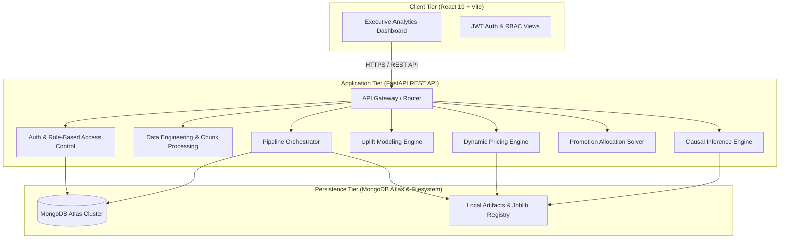

# EconoCausal — Dynamic Pricing & Promotion Optimization Engine

[](https://fastapi.tiangolo.com)
[](https://reactjs.org)
[](https://www.mongodb.com/atlas)
[](https://github.com/py-why/EconML)
[]()

---

## 1. Project Overview

**EconoCausal** is an enterprise-grade Decision Intelligence and Causal AI platform that integrates causal inference, uplift modeling, dynamic pricing, and integer-programming promotion optimization into a unified, production-ready full-stack application.

Unlike purely correlational machine learning models that predict *what* customers will do under historical conditions, EconoCausal estimates the *causal impact* of promotional discounts and price adjustments on customer purchasing behavior, enabling retailers to maximize expected revenue or profit while respecting strict promotional marketing budgets.

---

## 2. Problem Statement

Retailers frequently offer blanket promotional discounts across customer bases, resulting in three major business inefficiencies:
1. **Subsidizing "Sure Things":** Giving margin-diluting discounts to customers who would have purchased regardless of promotion.
2. **Wasting Budget on "Lost Causes":** Spending marketing capital on disengaged users whose purchase probability remains near zero even with discounts.
3. **Triggering "Sleeping Dogs":** Causing negative uplift where promotional outreach annoys customers and decreases purchases.
4. **Sub-optimal Price Elasticity:** Setting prices without accounting for confounding features (seasonality, loyalty history, category bias), leading to distorted demand curves.

EconoCausal solves these challenges by combining Double Machine Learning (DML), meta-learners (S/T/X-Learners), and integer programming to isolate "Persuadable" customer segments and identify profit-maximizing prices.

---

## 3. Key Features

- **Double Machine Learning (DML):** LinearDML and CausalForestDML estimators via EconML and DoWhy that control for multi-dimensional confounders and isolate true Average Treatment Effects (ATE).
- **Heterogeneous Uplift Modeling:** Causal meta-learners predicting Individual Treatment Effects (ITE) and categorizing customers into Persuadables, Sure Things, Lost Causes, and Sleeping Dogs with Qini and AUUC evaluation.
- **Dynamic Pricing Engine:** Arc elasticity calculations, bounds checking, margin/COGS constraints, and extrapolation warnings for optimal price recommendations.
- **Advanced Promotion Allocation Engine:** Integer-programming knapsack optimization choosing optimal multi-tiered discount percentages (e.g. 5%, 10%, 15%, 20%) under finite campaign budgets with strict exclusion of Sleeping Dogs.
- **Persistent Data & Model Registry:** MongoDB Atlas integration for user authentication, Role-Based Access Control (Admin, Analyst, Viewer), audit logging, and metadata sync.
- **End-to-End Orchestration API:** FastAPI modular REST architecture executing sequenced multi-stage pipelines with background execution and job status polling.
- **Executive & Analytical Dashboard:** Interactive React 19 + Vite dashboard with responsive KPI cards, Plotly.js visualizations, uplift segment distributions, and pricing curves.

---

## 4. Technology Stack

### Backend & Machine Learning
- **Python:** 3.14+
- **API Framework:** FastAPI, Starlette, Pydantic v2
- **Causal Inference:** EconML, DoWhy
- **Machine Learning:** Scikit-Learn, LightGBM, SciPy, NumPy, Pandas
- **Database & Persistence:** PyMongo, MongoDB Atlas, BCrypt, PyJWT
- **Testing:** Pytest, AnyIO, Mongomock

### Frontend
- **Framework:** React 19, Vite 8, Lucide React
- **Data Visualization:** Plotly.js, React-Plotly.js
- **Styling:** Modern CSS with custom dark enterprise theme

---

## 5. System Architecture



---

## 6. Project Folder Structure

```
D:\EconoCausal\
├── backend/
│   ├── api_v1.py               # REST API endpoints & router (Phases 8 & 9)
│   ├── auth.py                 # JWT token creation, decoding, & RBAC dependencies
│   ├── causal_engine.py        # Advanced causal inference engine & refutations
│   ├── causal_model.py         # Baseline causal ATE models
│   ├── config.py               # Central environment configuration & paths
│   ├── database.py             # MongoDB Atlas connection pool & lifecycle
│   ├── data_pipeline.py        # Chunk streaming, validation, & customer splitting
│   ├── drift_detection.py      # PSI & KS-test feature drift monitoring
│   ├── dynamic_pricing.py      # Demand curves & dynamic pricing recommendations
│   ├── main.py                 # FastAPI application factory & lifespan
│   ├── ml_pipeline.py          # Machine learning classification pipeline
│   ├── optimization.py         # Promotion optimization solvers & models
│   ├── schemas.py              # Pydantic request/response data schemas
│   ├── services.py             # Business logic, orchestration, & persistence services
│   ├── uplift_analysis.py      # Uplift modeling (S/T/X-Learner, Qini/AUUC)
│   ├── .env.example            # Backend environment template
│   └── requirements.txt        # Backend dependencies
├── frontend/
│   ├── src/
│   │   ├── components/         # Reusable UI widgets & KPI cards
│   │   ├── pages/              # Analytical dashboard page views
│   │   ├── services/           # Centralized API service client
│   │   ├── App.jsx             # React routing & application root
│   │   └── main.jsx            # React entry point
│   ├── vite.config.js          # Vite build & proxy configuration
│   ├── .env.example            # Frontend environment template
│   └── package.json            # Node.js dependencies
├── data/                       # Datasets, synthetic data, and splits
├── models/artifacts/           # Trained ML and causal model artifacts
├── tests/                      # Automated test suite (115 tests across 12 files)
│   └── conftest.py             # Pytest root configuration & mongomock isolation
├── README.md                   # Complete project documentation
├── PHASE_11_TESTING_PERFORMANCE_REPORT.md
└── PHASE_12_DEPLOYMENT_DOCUMENTATION_REPORT.md
```

---

## 7. Prerequisites

- **Python:** 3.11 to 3.14
- **Node.js:** v18.0.0 or higher (v20+ recommended)
- **Package Managers:** `pip` (Python) and `npm` (Node.js)
- **Database:** MongoDB Atlas account or local MongoDB 6.0+ instance

---

## 8. Installation Instructions

### Step 1: Clone the Repository
```bash
git clone https://github.com/adityagupta1089/EconoCausal.git
cd EconoCausal
```

### Step 2: Backend Setup
Create and activate a virtual environment:
```bash
# Windows
python -m venv backend\.venv
backend\.venv\Scripts\activate

# Linux / macOS
python3 -m venv backend/.venv
source backend/.venv/bin/activate

# Install dependencies
pip install -r backend/requirements.txt
```

### Step 3: Frontend Setup
```bash
cd frontend
npm install
cd ..
```

---

## 9. Environment Variable Configuration

### Backend Configuration
Copy the template file to create `backend/.env`:
```bash
cp backend/.env.example backend/.env
```
Edit `backend/.env` with your settings:
```ini
# MongoDB Atlas Connection String
MONGODB_URI=mongodb+srv://<username>:<password>@cluster0.ahxqm35.mongodb.net/econocausal?retryWrites=true&w=majority
DATABASE_NAME=econocausal

# JWT Secret (Generate with: openssl rand -hex 32)
JWT_SECRET_KEY=replace_with_a_secure_random_secret_key_at_least_32_chars
JWT_ACCESS_TOKEN_EXPIRES_MINUTES=30
JWT_ALGORITHM=HS256

# Environment
APP_ENV=development
ECONOCAUSAL_DEBUG=false
```

### Frontend Configuration
Copy the template file:
```bash
cp frontend/.env.example frontend/.env
```
For local development, leave `VITE_API_BASE_URL` empty to utilize the built-in Vite reverse proxy to `http://127.0.0.1:8000`.

---

## 10. MongoDB Atlas Setup

1. Create a free or dedicated cluster on [MongoDB Atlas](https://www.mongodb.com/cloud/atlas).
2. Under **Database Access**, create a user with `readWriteAnyDatabase` privileges.
3. Under **Network Access**, add your IP address (or `0.0.0.0/0` with secure credentials for container deployments).
4. In **Database Deployments**, click **Connect** -> **Drivers** -> Copy the connection string.
5. Paste the connection string into `backend/.env` as `MONGODB_URI`.
6. Indexes are created automatically upon application startup.

---

## 11. Running the Application Locally

### Starting the Backend Server
```bash
# From workspace root with activated virtual environment
python -m uvicorn backend.main:app --host 127.0.0.1 --port 8000 --reload
```
The backend API will be accessible at: `http://127.0.0.1:8000`

### Starting the Frontend Development Server
```bash
cd frontend
npm run dev
```
The frontend UI will be accessible at: `http://localhost:5173`

---

## 12. API Documentation Links

Once the backend is running, interactive API documentation is available at:
- **Swagger UI:** `http://127.0.0.1:8000/docs`
- **ReDoc:** `http://127.0.0.1:8000/redoc`
- **OpenAPI JSON:** `http://127.0.0.1:8000/openapi.json`

Key Endpoint Categories:
- `/api/auth/*` — User registration, login, profile, password management
- `/api/dashboard/*` — Executive overview, metrics, model performance, audit activity
- `/api/datasets/*` — CSV upload, schema preview, validation, metadata deletion
- `/api/training/*` — ML model training initiation, progress polling, metrics
- `/api/causal/*` — Causal inference analysis, DoWhy refutations, diagnostics
- `/api/uplift/*` — S/T/X-Learner analysis, customer segmentation, Qini curves
- `/api/pricing/*` — Single & batch dynamic price recommendations, elasticity
- `/api/promotions/*` — Budget-constrained integer programming coupon optimizer
- `/api/pipeline/*` — Sequential end-to-end pipeline orchestration

---

## 13. Testing Instructions

The complete regression test suite comprises 115 tests across 12 files.

Run all tests:
```bash
# Run complete test suite with verbose output
pytest tests/ -v

# Run targeted test suites
pytest tests/test_data_pipeline.py -v
pytest tests/test_phase8_auth_db.py -v
pytest tests/test_phase9_integration_orchestration.py -v
```

---

## 14. Model Training Instructions

To train all ML, causal, and pricing models sequentially from the command line:
```bash
# 1. Feature Engineering & Classification Models
python -m backend.ml_pipeline

# 2. Causal Inference Models & DoWhy Refutations
python -m backend.causal_engine

# 3. Heterogeneous Uplift Meta-Learners
python -m backend.uplift_analysis

# 4. Price Elasticity & Demand Models
python -m backend.dynamic_pricing
```
Model artifacts will be written to `models/artifacts/` and JSON evaluation reports to `data/synthetic/`.

---

## 15. Deployment Instructions

### Architecture
- **Frontend:** Hosted on [Vercel](https://vercel.com) as a single-page application.
- **Backend:** Hosted on [Render](https://render.com) as a Python web service.
- **Database:** Hosted on [MongoDB Atlas](https://www.mongodb.com/atlas).

### Backend (Render Web Service)
1. Link your GitHub repository in Render.
2. Select **Web Service** with Environment **Python 3**.
3. **Build Command:** `pip install -r backend/requirements.txt`
4. **Start Command:** `uvicorn backend.main:app --host 0.0.0.0 --port $PORT`
5. **Environment Variables:** Set `MONGODB_URI`, `DATABASE_NAME`, `JWT_SECRET_KEY`, `APP_ENV=production`.

### Frontend (Vercel)
1. Import repository into Vercel and select root directory as `frontend`.
2. **Framework Preset:** Vite
3. **Build Command:** `npm run build`
4. **Output Directory:** `dist`
5. **Environment Variables:** Set `VITE_API_BASE_URL` to your Render backend URL (e.g., `https://econocausal-api.onrender.com`).

---

## 16. Known Limitations

1. **CPU Causal Refutation Latency:** DoWhy random common cause and placebo refutations take 20–30 seconds each on single-threaded CPU architectures.
2. **In-Memory 1M Group Splitting:** Splitting 1,000,000+ rows via `GroupShuffleSplit` requires significant combinatorial RAM. Use chunked streaming (`process_large_dataset`) for dataset volumes over 500,000 rows.
3. **Plotly.js Bundle Chunk:** The frontend production bundle contains interactive Plotly.js (~4.9 MB uncompressed). Code-splitting with Vite's Rolldown engine is planned for future optimizations.

---

## 17. License & Authorship

- **Author:** Aditya Gupta
- **Project:** EconoCausal
- **Repository:** [https://github.com/adityagupta1089/EconoCausal](https://github.com/adityagupta1089/EconoCausal)
