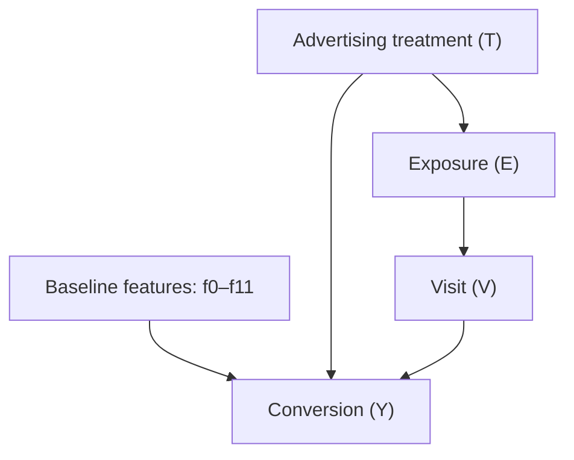


# EconoCausal — Causal DAG

## 1. Research Questions

### Primary question
What is the causal effect of ad targeting treatment on the probability of conversion?

### Secondary question
How does the estimated treatment effect vary across observations with different baseline feature profiles?

Important scope distinction: the Criteo dataset measures advertising treatment, not discount levels. Therefore, results from this dataset will be described as advertising uplift, not as a direct estimate of discount effectiveness. The existing synthetic retail dataset remains the controlled benchmark for discount-related analysis.

## 2. Dataset Variables

- T: Advertising treatment indicator.
- Y: Conversion outcome.
- V: Visit outcome.
- E: Exposure indicator.
- X: Anonymized baseline features f0 through f11.

The feature names are anonymized. Their individual business meanings and timing must not be assumed without supporting documentation.

## 3. Proposed Causal DAG

This is a working hypothesis, not a verified description of the data-generating process. The relationships involving exposure and visit require confirmation from the dataset documentation. The diagram must be revised if those definitions or their temporal ordering differ.

The graph does not include arrows from baseline features to treatment because the treatment assignment mechanism must first be verified. If treatment was randomized as documented by the dataset source, baseline features should not systematically determine assignment in expectation.

## 4. Identification Assumptions

1. **Treatment definition:** T consistently represents the advertising treatment being evaluated.
2. **Outcome definition:** Y consistently represents conversion for the observation.
3. **Exchangeability:** For observational treatment assignment, all important common causes of treatment and conversion must be adequately measured. Randomized assignment can support this assumption, subject to the dataset design and sampling process.
4. **Overlap:** Both treatment groups must have adequate representation in the covariate regions where effects are estimated.
5. **Pre-treatment covariates:** Only variables measured before treatment should be used as ordinary adjustment covariates unless a different causal role is explicitly justified.
6. **No leakage:** Post-treatment variables, including exposure when it occurs after assignment, must not be treated as baseline confounders.
7. **Consistency:** The treatment and outcome definitions must correspond to the same intervention and observation unit.
8. **Interference:** The analysis should assess whether one observation's treatment could affect another observation's outcome; this cannot be established from the sample alone.

## 5. Observed Data Warnings

The current 100,000-row sample has a strongly imbalanced treatment distribution. The observed conversion rates differ between treatment groups, but this raw difference is not, by itself, proof of a causal effect.

The sample also contains exact duplicate rows. These have been documented and retained pending a source-informed decision and sensitivity analysis. They must not be silently removed.

## 6. Identification and Evaluation Plan

- Verify the dataset's treatment assignment design and variable definitions.
- Inspect treatment overlap and feature balance before interpreting treatment effects.
- Estimate treatment effects using the planned Double Machine Learning workflow.
- Compare estimates with appropriate baselines and uncertainty measures.
- Use DoWhy refutation and sensitivity checks where the data and assumptions permit.
- Report limitations and avoid causal claims that the design does not support.

## 7. Limitations

- Anonymized features limit business-level interpretation.
- Dataset sampling and treatment imbalance may affect representativeness and precision.
- The observed data alone cannot verify every causal assumption.
- Advertising uplift does not directly establish the effect of a price discount.
- Any extrapolation to discount optimization requires separate evidence or clearly labeled synthetic experiments.

## 8. Source

Criteo AI Lab, Criteo Uplift Prediction Dataset: [https://ailab.criteo.com/criteo-uplift-prediction-dataset/](https://ailab.criteo.com/criteo-uplift-prediction-dataset/)

Diemert et al. (2018), "A Large Scale Benchmark for Uplift Modeling," AdKDD.